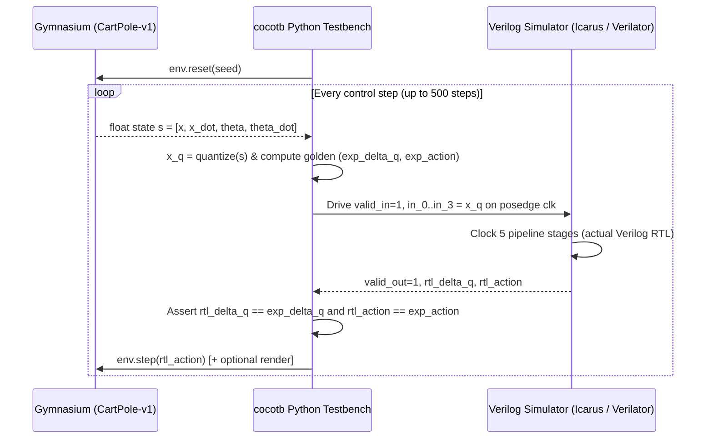

# Open-Source EDA Tools & `cocotb` Overview

A concise orientation to the open-source hardware tools used in this workflow, written for engineers familiar with traditional FPGA tools (Xilinx ISE/Vivado, Altera/Intel Quartus, ModelSim) who want to understand how the modern CLI-based open-source workflow maps to those concepts—and how to run every step manually on our generated GMDH and Dense designs. All commands below assume they are executed from this directory.

All manual commands below assume you have already exported and generated the 12-bit output directories. Each output directory is **self-contained** (`export_verilog.py` copies `rtl/gmdh_cell.v` into the GMDH folder and writes `hdl_manifest.json` so the directory can be moved or imported directly into external tools):
- **GMDH build**: `build/gmdh/12b/` (contains `gmdh_cell.v`, `gmdh_cartpole.v`, `tb_gmdh_cartpole.v`, `vectors.hex`, `quantized_model.json`, and `hdl_manifest.json`)
- **Dense build**: `build/dense/12b/` (contains `dense_cartpole.v`, `tb_dense_cartpole.v`, `vectors.hex`, `quantized_model.json`, and `hdl_manifest.json`)

*(Note: The generated RTL assumes `inputs=2, degree=1, interaction=0, forward=False`, no `GMDHNorm`, `Hardtanh`/`ReLU`/linear activations, and a 2-action folded dense output head; see [README.md — Known Limitations](README.md#5-known-limitations).)*

---

## 1. Icarus Verilog (`iverilog` + `vvp`)

### 1.1 Description & Official Links
- **What it is**: A classic, lightweight, event-driven Verilog compiler (`iverilog`) and runtime simulator (`vvp`).
- **Author**: Created and maintained by **Stephen Williams** with community contributors.
- **Official links**:
  - Documentation: <https://steveicarus.github.io/iverilog/>
  - Repository: <https://github.com/steveicarus/iverilog>

### 1.2 Introductory Usage & Common Examples
Icarus Verilog splits simulation into two explicit steps (similar to `vlog` + `vsim` in ModelSim):
1. **Compile** Verilog source files into a bytecode simulation file (`.vvp`):
   ```bash
   iverilog -g2005 -Wall -o sim.vvp design.v tb_design.v
   ```
   - `-g2005`: selects the IEEE 1364-2005 (Verilog-2001/2005) standard.
   - `-Wall`: enables all compiler warnings.
2. **Execute** the simulation with `vvp`:
   ```bash
   vvp sim.vvp
   ```

### 1.3 Manual Simulation for Our GMDH & Dense Models
Notice there is no heavy GUI "project file" — a project is simply the list of `.v` source files passed on the command line (or stored in a plain-text `-c filelist.f` file). Run from inside the build directory so `$readmemh("vectors.hex", ...)` finds `vectors.hex`:

- **GMDH model** (uses the local copy of `gmdh_cell.v` alongside the generated top-level):
  ```bash
  cd build/gmdh/12b
  iverilog -g2005 -Wall -o sim_gmdh.vvp gmdh_cell.v gmdh_cartpole.v tb_gmdh_cartpole.v
  vvp sim_gmdh.vvp
  ```
- **Dense model** (single self-contained RTL file):
  ```bash
  cd build/dense/12b
  iverilog -g2005 -Wall -o sim_dense.vvp dense_cartpole.v tb_dense_cartpole.v
  vvp sim_dense.vvp
  ```

### 1.4 Comparison with Traditional Tools
- **Closest traditional equivalent**: **ModelSim / QuestaSim** or **Xilinx ISim / Vivado `xsim`** (event-driven behavioral simulation).
- **Trade-offs**: Instant compilation (~0.1s) and zero licensing/GUI overhead, ideal for unit tests and small-to-medium RTL. Slower than Verilator on millions of clock cycles, and its SystemVerilog (`-g2012`) support is partial—which is one reason our generator emits strict Verilog-2001.

---

## 2. Verilator

### 2.1 Description & Official Links
- **What it is**: The industry-standard open-source high-speed Verilog/SystemVerilog simulator and linter. Instead of interpreting events, Verilator **transpiles Verilog into optimized C++** and compiles a native multithreaded executable.
- **Author / Organization**: Created by **Wilson Snyder** (Veripool), now hosted under the **CHIPS Alliance / Linux Foundation** with broad industry backing.
- **Official links**:
  - Homepage & manual: <https://verilator.org>
  - Repository: <https://github.com/verilator/verilator>

### 2.2 Introductory Usage & Common Examples
- **Fast static linting only** (catches width mismatches, latches, and sensitivity bugs without building a binary):
  ```bash
  verilator --lint-only -Wall design.v
  ```
- **Compile & run a Verilog testbench** (Verilator 5+ supports `--binary --timing` for delays like `#5` and `@(posedge clk)`):
  ```bash
  verilator --binary -j 0 --timing --top-module tb_design design.v tb_design.v
  ./obj_dir/Vtb_design
  ```

### 2.3 Manual Simulation for Our GMDH & Dense Models
Run from inside the respective build directory:

- **GMDH model**:
  ```bash
  cd build/gmdh/12b
  verilator --binary -j 0 --timing --Mdir obj_gmdh --top-module tb_gmdh_cartpole \
      gmdh_cell.v gmdh_cartpole.v tb_gmdh_cartpole.v
  ./obj_gmdh/Vtb_gmdh_cartpole
  ```
- **Dense model**:
  ```bash
  cd build/dense/12b
  verilator --binary -j 0 --timing --Mdir obj_dense --top-module tb_dense_cartpole \
      dense_cartpole.v tb_dense_cartpole.v
  ./obj_dense/Vtb_dense_cartpole
  ```

### 2.4 Comparison with Traditional Tools
- **Closest traditional equivalent**: High-speed compiled simulators like **Synopsys VCS** or **Cadence Xcelium** (for synthesizable RTL).
- **Trade-offs**: Higher one-time C++ build time (a few seconds), but **10×–100× faster runtime** than Icarus Verilog or ModelSim—making it great for long closed-loop RL rollouts or sweeping hundreds of CartPole episodes in RTL. It focuses on 2-state synthesizable logic (not full analog/gate-level timing back-annotation).

---

## 3. Yosys (Yosys Open SYnthesis Suite)

### 3.1 Description & Official Links
- **What it is**: An extensible open-source **RTL synthesis framework** that reads Verilog, optimizes the logic, infers multipliers/DSPs/flip-flops/memories, maps them onto target FPGA primitives (Xilinx 7-series, Lattice ECP5/iCE40, Gowin, Intel/Altera), and outputs netlists (`.json`, `.edif`, `.blif`) and area statistics.
- **Author / Organization**: Created by **Claire Wolf**, developed and maintained by **YosysHQ**.
- **Official links**:
  - Homepage: <https://yosyshq.net/yosys/>
  - Repository: <https://github.com/YosysHQ/yosys>

### 3.2 Introductory Usage & Common Examples
Yosys is driven by short script commands (either interactively via `yosys`, from a `.ys` script via `yosys -s synth.ys`, or inline via `yosys -p "..."`):
```bash
# Read RTL, synthesize for Xilinx 7-series, and print LUT/FF/DSP counts
yosys -p "read_verilog design.v; synth_xilinx -top my_top; stat"

# Or export a JSON netlist for nextpnr place-and-route (e.g., Lattice ECP5)
yosys -p "read_verilog design.v; synth_ecp5 -top my_top -json my_top.json"
```
Yosys also includes `show` (via Graphviz `dot`) to render a schematic diagram of any module.

### 3.3 Manual Synthesis Projects for Our GMDH & Dense Models
A manual "synthesis project" in Yosys is just a tiny `.ys` script file (analogous to a Vivado Tcl synthesis script):

- **GMDH model** (`synth_gmdh.ys` inside `build/gmdh/12b/`):
  ```text
  read_verilog gmdh_cell.v
  read_verilog gmdh_cartpole.v
  synth_xilinx -flatten -top gmdh_cartpole
  stat
  ```
  Run with: `yosys -s synth_gmdh.ys` (swap `synth_xilinx` for `synth_ecp5`, `synth_ice40`, or `synth_gowin` to compare FPGA families).

- **Dense model** (`synth_dense.ys` inside `build/dense/12b/`):
  ```text
  read_verilog dense_cartpole.v
  synth_xilinx -flatten -top dense_cartpole
  stat
  ```
  Run with: `yosys -s synth_dense.ys`.

*(To save machine-readable statistics just like `run_flow.py`, replace `stat` with `tee -q -o stat.json stat -json`.)*

### 3.4 Comparison with Traditional Tools
- **Closest traditional equivalent**: **Xilinx XST / Vivado Synthesis (`synth_design`)** or **Altera/Intel Quartus Analysis & Synthesis (`quartus_map`)**.
- **Trade-offs**: Runs in seconds on macOS/Linux/Windows with a tiny install footprint (no 50 GB vendor IDE), and supports multiple FPGA vendors with one command. Vendor tools (Vivado/Quartus) still remain necessary for final vendor-specific timing closure and bitstreams on proprietary Xilinx/Altera devices—and our standard Verilog-2001 files import straight into Vivado/Quartus (`Add Sources` → select `gmdh_cell.v` + `gmdh_cartpole.v` or `dense_cartpole.v`) with zero modifications.

---

## 4. `nextpnr` (Place-and-Route & Timing Analysis)

### 4.1 Description & Official Links
- **What it is**: A portable, timing-driven open-source FPGA **place-and-route** tool that takes a synthesized Yosys JSON netlist, places logic into physical FPGA tiles, routes interconnects, reports static timing (`Fmax`), and prepares output for bitstream packing.
- **Author / Organization**: Initially developed by **Myrtle Shah** under the **YosysHQ** ecosystem with wide community contributions.
- **Official links**:
  - Repository: <https://github.com/YosysHQ/nextpnr>
  - Ecosystem: <https://yosyshq.com>

### 4.2 Introductory Usage & Common Examples
Each FPGA architecture has its own `nextpnr` binary (included in **OSS CAD Suite**): `nextpnr-ecp5` (Lattice ECP5), `nextpnr-ice40` (Lattice iCE40), and `nextpnr-himbaechel` (Gowin).

```bash
# Example: place & route an ECP5 netlist with a 100 MHz clock constraint and report Fmax
nextpnr-ecp5 --45k --package CABGA381 --freq 100 --json design.json --textcfg design.config
```

### 4.3 Manual Place-and-Route for Our GMDH & Dense Models (ECP5 Example)
1. Synthesize to JSON with Yosys:
   - **GMDH**:
     ```bash
     cd build/gmdh/12b
     yosys -p "read_verilog gmdh_cell.v gmdh_cartpole.v; synth_ecp5 -top gmdh_cartpole -json gmdh.json"
     nextpnr-ecp5 --45k --package CABGA381 --freq 100 --json gmdh.json --textcfg gmdh.config
     ```
   - **Dense** (note: `dense/12b` uses 94 `MULT18X18D`, which fits an `--85k` ECP5 device with 156 DSPs, whereas `gmdh/12b` uses 48 DSPs and already fits a smaller `--45k` device with 72 DSPs!):
     ```bash
     cd build/dense/12b
     yosys -p "read_verilog dense_cartpole.v; synth_ecp5 -top dense_cartpole -json dense.json"
     nextpnr-ecp5 --85k --package CABGA381 --freq 100 --json dense.json --textcfg dense.config
     ```
   *(For a real board, you would also pass a pin-constraint file `--lpf board.lpf` and run `ecppack` to generate the `.bit` bitstream.)*

### 4.4 Comparison with Traditional Tools
- **Closest traditional equivalent**: **Xilinx ISE Map/PAR**, **Vivado Implementation (`opt_design`, `place_design`, `route_design`, `report_timing`)**, or **Quartus Fitter (`quartus_fit` + `quartus_sta`)**.
- **Trade-offs**: Provides real physical routing and `Fmax` numbers on macOS/Linux/Windows for open-source-supported FPGAs (Lattice iCE40/ECP5, Gowin). For Xilinx 7-series / UltraScale+ or Intel/Altera devices, you would still run place-and-route in Vivado or Quartus on Linux/Windows.

---

## 5. Waveform Viewers (`GTKWave` & `Surfer`)

- **GTKWave** (by **Tony Bybell**, <https://gtkwave.sourceforge.net>, bundled in OSS CAD Suite) and **Surfer** (<https://surfer-project.org>, fast Rust-based viewer that runs smoothly on macOS) are the open-source equivalents of the ModelSim/Vivado Wave window.
- To capture a `.vcd` waveform in any testbench, add `$dumpfile("wave.vcd"); $dumpvars(0, tb_gmdh_cartpole);` inside `initial begin`, re-run `vvp`, and open `wave.vcd` in Surfer or GTKWave.

---

## 6. `cocotb` & Closed-Loop Verification (`test_cartpole_cocotb.py`)

### 6.1 Description & Official Links
- **What it is**: **CO-routine based CO-simulation Testbench** — a Python library that lets you write hardware testbenches in standard Python (`async`/`await`) instead of Verilog/VHDL. Under the hood, `cocotb` attaches to a standard simulator (`iverilog`, `verilator`, `ghdl`, ModelSim, VCS, etc.) through standard simulator interfaces (VPI/VHPI/DPI), driving input pins and reading output pins cycle-by-cycle while the simulator evaluates your actual RTL.
- **Author / Organization**: Originally created at **Potential Ventures** (Chris Higgs et al.), now an independent project under the **FOSSi Foundation**.
- **Official links**:
  - Homepage & docs: <https://www.cocotb.org>
  - Repository: <https://github.com/cocotb/cocotb>

### 6.2 How `test_cartpole_cocotb.py` Works
In a traditional Verilog testbench (`tb_gmdh_cartpole.v`), the simulator can only replay pre-recorded static vectors from `vectors.hex` because Verilog cannot run a physics engine like Gymnasium's `CartPole-v1`. `cocotb` solves this by putting the **compiled Verilog RTL directly inside the Python physics loop**:



Two details make `test_cartpole_cocotb.py` compact and self-contained:
1. **Single-file runner + test**: `main()` uses `cocotb_tools.runner.get_runner(sim_name)` to compile the Verilog sources and launch the simulator, which imports the same file back as `test_module="test_cartpole_cocotb"` and executes `@cocotb.test() async def test_closed_loop_cartpole(dut)`.
2. **Post-NBA sampling (`await Timer(1, "ns")`)**: After each `RisingEdge(dut.clk)`, waiting `1 ns` (on a `10 ns` clock) lets Verilog's non-blocking register assignments (`<=`) settle before reading `dut.valid_out`, `dut.delta_q.value.to_signed()`, and `int(dut.action.value)`.
3. **Structured output**: When all episodes complete with zero bit mismatches, it saves `rtl_eval.json` into the build directory. *(Limitation: `test_cartpole_cocotb.py` currently hardcodes `CartPole-v1` and a 1-bit folded `action` output; multi-action or other Gymnasium environments are planned as future work.)*

### 6.3 FAQ: Differences Between GMDH & Dense Simulations

#### Q1: What is the difference between simulating the Dense model and the GMDH model?
From the perspective of the testbench (`tb_*.v`, `run_flow.py`, and `test_cartpole_cocotb.py`), **the simulation protocol is identical**:
- Both `gmdh_cartpole.v` and `dense_cartpole.v` expose the **exact same port interface** (`clk`, `rst_n`, `valid_in`, `in_0..in_3`, `valid_out`, `action`, `delta_q`) and the **exact same `len(layers) + 1`-cycle pipeline latency** (5 cycles for our 4-layer models).
- The **only differences** are:
  1. **Source files compiled**: GMDH compiles **two** RTL files inside the build directory (`gmdh_cell.v` + `gmdh_cartpole.v`), whereas Dense compiles **one** file (`dense_cartpole.v`).
  2. **Internal hardware evaluated**: GMDH simulates 23 hierarchical instances of `gmdh_cell` (each taking 2 inputs with `Hardtanh(-2, 2)` clamping, 50 total multipliers), whereas Dense simulates flat inline multiply-accumulate expressions (variable fan-in `4, 6, 7, 10` with `ReLU` clamping, 146 total multipliers).

#### Q2: Why is there a `gmdh_cell.v` primitive, but not a `dense_cell.v`?
This comes down to **structural uniformity** and **Verilog-2001 readability**:
- **Every GMDH hidden neuron has an identical, fixed fan-in of 2** (`x1`, `x2`, and 3 scalar parameters `W0`, `W1`, `W2`). That maps naturally to one clean, reusable 49-line Verilog-2001 module (`gmdh_cell.v`) with plain scalar ports and parameters.
- **Dense neurons have different fan-ins in every layer** (`4`, `6`, `7`, and `10` inputs in `../dense.pth`). Plain **Verilog-2001** does not support variable-length unpacked array ports or parameters (e.g., `input signed [W-1:0] x [0:N-1]`). Creating a single generic `dense_cell.v` in Verilog-2001 would require flattening all inputs and weights into wide packed bit-vectors (`[N*DATA_W-1:0]`) and slicing them inside `generate` loops—which is much harder to read and audit.
- Generating each dense neuron's MAC directly as an explicit signed sum in `dense_cartpole.v` keeps the baseline RTL crystal clear and strictly Verilog-2001 compliant, while also highlighting **one of GMDH's practical hardware advantages**: its entire hidden network is built from one uniform, modular 2-input hardware cell.
